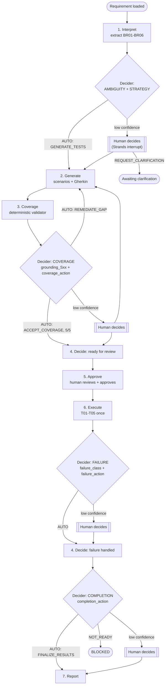

# Assurance Agent Experience

An AI test-engineer agent for **payment retry & duplicate-charge prevention**. It interprets a requirement, writes and grounds test scenarios, waits for a human to approve, runs the real test suite, and reports the result — with [Strands Decider 2B](https://github.com/strands-labs/strands-decider) gating every key decision along the way, and a human in the loop whenever the Decider isn't confident enough to decide on its own.

Built for the AWS Agent Experience Hackathon, pattern `#guardrails`.

**Demo video:** _link coming_ · **Write-up:** _link coming_

## The problem

A customer pays $100 once. The gateway re-sends its success callback, the store records it twice, and the books show $200.

**Impact:** Inflated revenue, failed reconciliations, and wrong refunds or orders shipped twice.

**Mitigation:** Assurance Agent Experience builds and runs the tests; the Strands Decider checks each key decision so no scenario is missed. Test T04 catches the duplicate (expected 1 ledger entry, found 2) before it reaches production.

## How it works

Seven steps, four Decider checkpoints, deterministic guards underneath every one of them:

1. **Interpret** — extracts business rules BR01–BR06 from the fixed requirement text (Bedrock), records any ambiguities with a critical/non-critical flag.
2. **Generate** — writes test scenarios (S01, S02, S03, S05) with Gherkin (Bedrock). S04 is deliberately left out — a seeded, openly-labelled gap.
3. **Coverage** — a deterministic validator computes Required Scenario Coverage (4/5 initially) and the per-rule traceability matrix.
4. **Decide** — the Decider checkpoints below gate every transition between these steps; see "The four checkpoints."
5. **Approve** — a human reviews the final scenarios, coverage, and the fixed T01–T05 manifest, then clicks Approve. Nothing executes before this.
6. **Execute** — the approved T01–T05 suite runs once against an in-memory mock. T04 fails for real (expected 1 ledger posting, got 2 — the injected defect).
7. **Report** — a downloadable Markdown report: *agent workflow COMPLETED, payment verification FAILED (BR06)*.



### The four Decider checkpoints

Every checkpoint sends the Decider a *question* (what to decide) plus *state* (the evidence it needs) in one HTTP call, and gets back a confidence-scored answer per question:

| Checkpoint | Questions | What they decide |
|---|---|---|
| **AMBIGUITY + STRATEGY** | `ambiguity_BR01`…`ambiguity_BR06` (true/false, one per rule) + `strategy_action` (choice) | Whether any rule has a genuinely critical open question, and whether to generate scenarios now or request human clarification first. |
| **COVERAGE** | `grounding_S01`…`grounding_S05` (true/false, one per scenario) + `coverage_action` (choice) | Whether each scenario's Gherkin actually asserts what its structured oracle requires, and whether to accept coverage or remediate the one missing/invalid scenario. |
| **FAILURE** | `failure_class` (choice) + `failure_action` (choice) | Whether a test failure is a real business-rule violation, an infrastructure problem, or insufficient evidence — and whether to investigate further (one bounded, read-only pass) or report now. |
| **COMPLETION** | `completion_action` (choice) | Whether the evidence (results, and analysis if something failed) is complete and consistent enough to finalize the report. |

### Thresholds

- **Choice questions** (2+ named options): confidence is the Decider's own **top-two-probability margin** (the gap between its best and second-best option — 0 means a coin flip, 1 means certain). `AUTO` at **≥ 0.75**, otherwise escalate.
- **True/false (`noul`) questions**: `AUTO`+`true` at **p ≥ 0.80**, `AUTO`+`false` at **p ≤ 0.40**, otherwise escalate (the 0.40–0.80 band is deliberately wide).

### Deterministic guards

Confidence **routes** a decision; it never **overrides** a guard. A few guards that hold regardless of what the Decider or a human says:

- `ACCEPT_COVERAGE` is denied outright unless coverage is actually 5/5 valid.
- `BUSINESS_RULE_VIOLATION` is denied unless a test genuinely failed in `results.json`.
- `FINALIZE_RESULTS` is denied if `results.json` (or `analysis.json`, when a test failed) is missing.
- At most one remediation cycle, one approved execution batch, ever.

### Human escalation

When any question in a checkpoint escalates, the whole checkpoint pauses via a [Strands `InterventionHandler`](https://strandsagents.com/docs/api/python/strands.interventions.handler/index.md) `Confirm` interrupt — the UI shows the Decider's suggestion, confidence, and probabilities, and a human picks an option. The human's answer flows through the exact same deterministic guards as an `AUTO` decision; nothing about escalation weakens enforcement.

### Evidence

Everything lands as plain JSON/Markdown under `runs/<run_id>/`: `interpretation.json`, `scenarios_vN.json` / `coverage_vN.json` / `grounding_vN.json` per version, `approval.json`, `results.json`, `analysis.json`, `decisions.json` (every Decider call and human answer, with confidence and rationale), `report.md`. No database.

## Why the Decider

- **Speed and cost.** In our calibration benchmark (below), the Decider answered in **718ms (p50)** / **1968ms (p95)** vs **921ms (p50)** / **2860ms (p95)** for the same question put to Claude on Bedrock. Bedrock costs roughly **$0.0026 per decision**; the Decider has no per-call API fee, but it runs on a GPU EC2 instance (g4dn.xlarge, roughly **$0.50/hour** while the instance is on).
- **The safety property.** A small, fast, narrowly-scoped model is cheap enough to call at *every* key decision point, which means every key decision gets a confidence score and a human fallback — not just the ones expensive enough to justify an LLM call. Confidence routes; it never decides past a guard. In our benchmark the only wrong `AUTO` was a conservative false "no match" (see below); guards and human approval still back every step, but we don't claim a wrong `AUTO` can never let something through.

## Calibration results

Full methodology, the labeled benchmark, and both raw runs are in [`scripts/benchmark_decider.py`](scripts/benchmark_decider.py), [`benchmarks/decider_benchmark.json`](benchmarks/decider_benchmark.json), and [`benchmarks/results_20261022T041327Z.md`](benchmarks/results_20261022T041327Z.md) (the live run this section summarizes). See [PATTERN.md](PATTERN.md) for the reusable write-up of the approach.

**What changed, before → after one round of wording fixes** (no threshold changes — see below):

| | Before | After |
|---|---|---|
| `ambiguity_BRxx` accuracy | 50% | **100%** |
| `grounding_Sxx` escalation rate | 88% | **63%** |

**AUTO-decision correctness** (after run, 41 labeled items): 21 AUTO decisions were made; **20/21 (95%) were correct**. The one exception: a real, non-held-out scenario (`grounding_S03`) was auto-decided "not grounded" (`false`) when it was actually faithful to its oracle — a **conservative failure mode**: a false "no match" pushes toward a coverage gap and a remediation/human-review cycle, never toward wrongly accepting a bad scenario as grounded.

**Held-out items** (10 items, 2 per changed question type, labelled *before* any wording was written and never used to tune it): held-out items have no "before" run to compare against, but held-out accuracy tracked the after-fix training accuracy per type — where a type was still weak after fixing (`failure_action`, `strategy_action`), it was weak held-out too, and where a type scored well after fixing, held-out scored well too. No sign the fixes were overfit to the exact items used to justify them, on this small sample.

**Decider vs Claude (Bedrock)**, same questions, same state, same run: Decider p50 **718ms** / p95 **1968ms** vs Claude p50 **921ms** / p95 **2860ms**; Claude cost ~**$0.0026/decision**, the Decider has no per-call fee but runs on a GPU EC2 instance (g4dn.xlarge, ~**$0.50/hour** while on); Claude's judgement was also *more accurate overall* in this sample (≈96% average vs ≈83% for the Decider across question types) — unsurprising for a 2B model vs a frontier LLM, and exactly why the Decider only *auto-decides the easy, high-confidence cases* and hands everything else to a human rather than trying to match Claude's judgement across the board.

**A measurement bug, found and fixed, not hidden:** the first "before" run showed 0% Bedrock accuracy on every true/false question. That was a benchmark-harness bug — it told Bedrock to answer with the quoted strings `"true"`/`"false"` instead of a real JSON boolean, so a correct answer never matched the label. Corrected offline from that same run's saved raw answers (no re-run): **67%** / **100%**. The harness was fixed before the "after" run; see `scripts/benchmark_decider.py`'s `_coerce_noul_answer`.

**Known limits:**
- `failure_action` and `strategy_action` still escalate most of the time, even after wording fixes that embed concrete facts in their instructions — not every miscalibration is a wording problem.
- Escalation is evaluated **per checkpoint**, not per question: one low-confidence question anywhere in a checkpoint escalates the whole checkpoint, so the *weakest* question in a batch decides whether a human sees it.
- The `ambiguity_BRxx` fix ties true/false to a `CRITICAL` tag that comes from the **interpretation step's own classification**, not computed fresh at this checkpoint — so this question now effectively checks/confirms that upstream tag rather than independently judging ambiguity from scratch.

Thresholds (`config/decider.json`) are **unchanged** in this work — per-question-type sample sizes (n=4–8 training, n=2 held-out) are too small to justify moving them in either direction; this benchmark's job was to measure, not to tune on noise.

## Running it

### Prerequisites

- Python 3.12+, [`uv`](https://docs.astral.sh/uv/) (the repo ships `uv.lock`) — or plain `pip`.
- A Decider 2B server reachable at `AITE_DECIDER_URL` (default `http://127.0.0.1:8000`). For local dev, run `strands-decider serve <model> --port 8000` yourself. For the hackathon demo, the Decider runs on a GPU EC2 host and is reached locally through an SSM port-forward — never exposed publicly:
  ```bash
  aws ssm start-session \
    --target <INSTANCE_ID> \
    --document-name AWS-StartPortForwardingSession \
    --parameters '{"portNumber":["8000"],"localPortNumber":["8000"]}'
  ```
- AWS credentials with Bedrock access (`bedrock:InvokeModel` for the configured model) — a named profile for local dev, an instance role on EC2. No keys in code or logs.

### Environment variables (names only — see `.env.example` for the full list with safe defaults)

`AWS_PROFILE`, `AWS_REGION`, `AWS_DEFAULT_REGION`, `AITE_BEDROCK_MODEL_ID`, `AITE_BENCH_JUDGE_MODEL_ID`, `AITE_DECIDER_URL`, `AITE_DECIDER_MODEL`, `AITE_DECIDER_HOST_LABEL`, `AITE_DECIDER_THRESHOLD`, `AITE_DECIDER_TIMEOUT_SECONDS`, `AITE_ARTIFACT_ROOT`, `AITE_DUPLICATE_LEDGER_DEFECT`, `AITE_GENERATION_TIMEOUT_SECONDS`, `AITE_PYTEST_TIMEOUT_SECONDS`.

### Run the app

```bash
uv sync
uv run streamlit run src/ai_test_engineer/ui.py
```

### Run the tests

```bash
uv run pytest                      # full suite, live/* deselected by default
uv run pytest tests/live -m live    # real-Decider smoke tests (needs a running Decider)
```

### Run the calibration benchmark

```bash
uv run python scripts/benchmark_decider.py                              # full benchmark
uv run python scripts/benchmark_decider.py --only grounding_Sxx --limit 5  # one type, a few items
```
Needs a reachable Decider (above) and Bedrock access; writes `benchmarks/results_<timestamp>.{json,md}`.

## Deviations from the original spec

- **F08/F09 use a deterministic narrative, not Bedrock.** The spec leaves the failure-analysis and final-report narrative implementation-defined; `checkpoints.py`'s `_analysis_record` and `reporting.render_report` build both from captured, structured facts (expected/actual/rule text/evidence references) rather than an LLM call — deterministic, reproducible, and never able to fabricate a finding.
- **F06's artifact-binding is version-based, not hash-based.** The original data-contract design (`docs/05_Data_Contracts.md`) specifies a `bundle_hash`/`test_manifest_hash` (SHA-256) binding so a changed artifact can't reuse a stale approval. What's implemented instead binds approval to an integer `scenario_set_version` and checks `approval_blockers` against it — equivalent in practice for this fixed pipeline (any artifact change bumps the version), but the literal SHA-256 bundle-hash binding named in the design was not implemented or separately verified.

## Roadmap

- **Derive the scenario catalog from the business rules.** `config/scenario_catalog.json` is a hand-written fixture today, independent of `BR01`–`BR06`'s text — generating it from the rules would remove a place the two can silently drift apart.
- **Compose generated tests from reusable primitives** instead of five bespoke scenarios, so a new rule set doesn't mean writing a new oracle from scratch.
- **Carry rule-match (grounding) answers forward** across scenario-set versions, so remediation doesn't force a human to re-answer a grounding question they already resolved for an unchanged scenario.
- **A FastAPI + React UI** in place of the single-process Streamlit app, for multi-user review and a production-shaped deployment story.

## Repo layout

```
src/ai_test_engineer/   # orchestration, checkpoints (Decider wiring), coverage, execution,
                         # reporting, state/controller, Streamlit UI, mock payment service
decider_gate/            # the reusable, domain-agnostic Decider guardrail package (see PATTERN.md)
config/                  # requirement.json, scenario_catalog.json, test_manifest.json, decider.json
scripts/                 # run_initial_pass.py (interactive run), benchmark_decider.py
benchmarks/              # decider_benchmark.json (labeled items) + live benchmark results
tests/                   # unit/, payment/ (T01-T05), ui/, live/ (real-Decider smoke tests)
docs/                    # the original design package (requirements, architecture, build brief, ...)
runs/                    # per-run evidence (gitignored)
```

## License

MIT — see [LICENSE](LICENSE).
