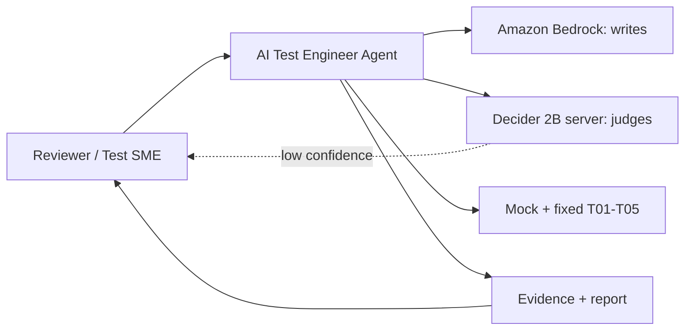
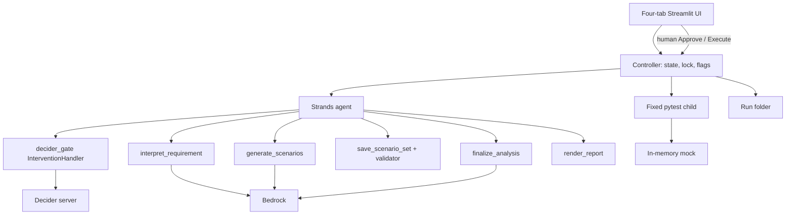
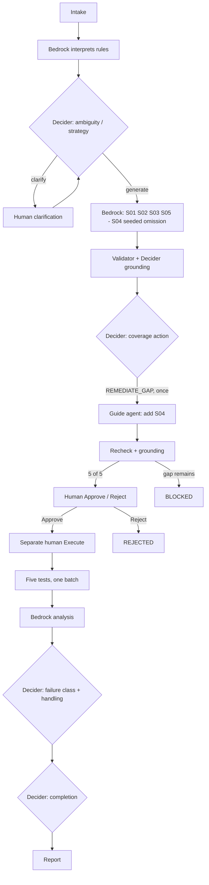
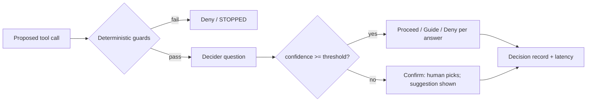
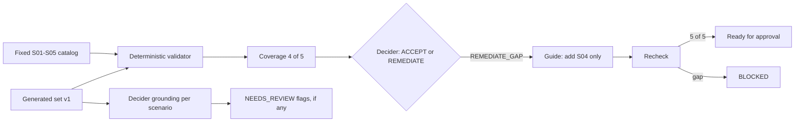
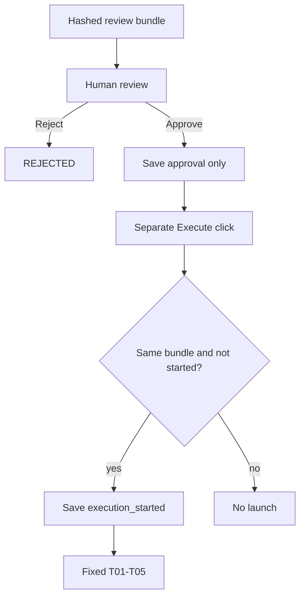
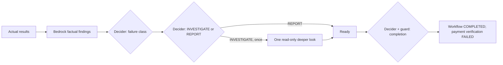
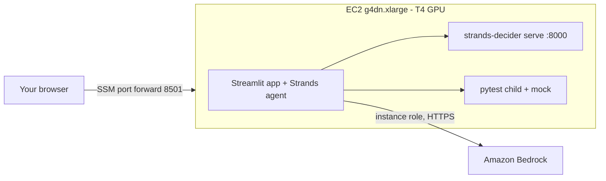

# Agent Architecture

**Project:** AI Test Engineer Agent  
**Use case:** Payment Retry & Duplicate Charge Prevention  
**Revision 2 (Oct 13, 2026):** Decider served by `strands-decider serve` (local for dev, EC2 GPU for demo); Decider wired into the Strands agent through an `InterventionHandler`; confidence-based human escalation; reusable `decider_gate` package.

## 1. Design in one paragraph

One Python application: a four-tab Streamlit UI, one Strands agent (the orchestrator) with a small set of tools, one controller that owns state, a lock and single-use flags, and one sequential worker. **Bedrock writes** (interpretation, scenarios, Gherkin, failure analysis). **Decider judges** (ambiguity, strategy, scenario grounding, coverage action, failure handling, completion), each answer carrying a confidence; low confidence goes to the human. Deterministic code owns approval, state transitions and the one-batch rule. Pytest runs the five fixed tests against a fresh in-process mock. Evidence is plain JSON + Markdown in a run folder.

Approval and execution stay separate: Approve records authorization; only a later human Execute click launches the batch. Browser reload reads the same process-owned controller. On process restart, unfinished work is marked STOPPED and never replayed.

## 2. Components and boundaries

| Where | Components | Notes |
|---|---|---|
| App host (Windows for dev; EC2 for the demo and submission, per the Rules) | Streamlit, Strands agent + tools, `decider_gate` guardrail, controller, worker, run folder | Streamlit bound to localhost. Model output treated as untrusted data. |
| Child process | Fixed T01–T05 pytest + fresh in-memory fixtures | Fixed argument vector; no AWS credentials passed in. |
| Decider server | `strands-decider serve` on localhost:8000 (dev: local machine; demo: EC2 GPU) | Never exposed publicly. Remote access only via SSM port forwarding. |
| Amazon Bedrock | Generation/analysis model; benchmark judge model | IAM-authenticated HTTPS; synthetic content only. |

**Credentials:** dev uses a named AWS profile; on EC2 the instance role grants `bedrock:InvokeModel` for the chosen model(s) and SSM access. No keys in code or logs.

## 3. Strands wiring

```python
# Sketch only — verify names against the pinned strands-agents version (O03).
from strands import Agent
from strands.interventions import InterventionHandler, Proceed, Guide, Deny, Confirm
from decider_gate import DeciderClient, ConfidenceGate, DeciderGuardrail

guardrail = DeciderGuardrail(
    client=DeciderClient(url=cfg.decider_url, timeout_s=cfg.decider_timeout_s),
    gate=ConfidenceGate(threshold=cfg.decider_threshold),
    checkpoints={                       # tool name -> question builder + verdict mapping
        "generate_scenarios": strategy_and_ambiguity_check,
        "save_scenario_set":  grounding_and_coverage_check,
        "finalize_analysis":  failure_check,
        "render_report":      completion_check,
    },
    controller=controller,              # deterministic guards + used-flags + audit
)

agent = Agent(model=bedrock_model, tools=stage_tools, interventions=[guardrail])
```

- Tools available to the agent are limited per stage by the controller.
- `run_tests` is **not** an agent tool. Only the human Execute handler can launch pytest.
- `Confirm` (low-confidence escalation) surfaces as a Strands interrupt; the controller stores it, the UI shows options + Decider's suggestion, and the human's answer resumes the agent. If interventions are unavailable in the pinned version, the controller calls the guardrail before each tool instead (same code, different hook).

## 4. Diagrams

### 1. System context



### 2. Components



### 3. End-to-end flow



Any low-confidence Decider answer pauses at that point for the human to confirm or pick. Errors stop with retained evidence.

### 4. Confidence-gated decision



### 5. Coverage gap and remediation



Grounding flags can only lower trust (send a scenario to human review); they never turn an invalid scenario valid.

### 6. Approval and execution



### 7. Failure analysis and reporting



### 8. Demo deployment (required: the Rules say the agent runs on AWS)



Dev deployment is the same picture on your Windows machine with Decider on CPU (or WSL2).

## 5. Hosting facts and risks

| Fact / risk | Detail |
|---|---|
| Decider runs on CPU and GPU | Project README; published median ~115 ms/question on RTX 3090. CPU is seconds per question. |
| AWS-hosted measurements | A published AWS Builder experiment measured ~475 ms warm per decision on a T4 GPU and ~9 s on AgentCore CPU microVMs, with identical accuracy across hosts. |
| Silent CPU fallback | The same experiment found GPU hosts silently running on CPU until fixed. Log `torch.cuda.get_device_name()` at startup; fail health check if CUDA is absent. |
| GPU quota | New accounts often have 0 vCPU quota for G instances. Request early (O02). |
| Cost | Stop the instance when idle; terminate after submission. |
| Not assumed | Decider is not a managed Bedrock model; no Custom Model Import assumption. |

Sources: [Decider project](https://github.com/strands-labs/strands-decider), [AWS Builder: Decider 2B on AgentCore vs GPU](https://builder.aws.com/content/3KJvK45IGyUNQwRd4dSOZQWKv8I/running-strands-decider-b-on-amazon-bedrock-agent-core-micro-vms-vs-gpu-instances), [Strands InterventionHandler API](https://strandsagents.com/docs/api/python/strands.interventions.handler/index.md), [Strands Bedrock provider](https://strandsagents.com/docs/api/python/strands.models.bedrock/), [SSM port forwarding](https://docs.aws.amazon.com/systems-manager/latest/userguide/session-manager-working-with-sessions-start.html#sessions-remote-port-forwarding).
